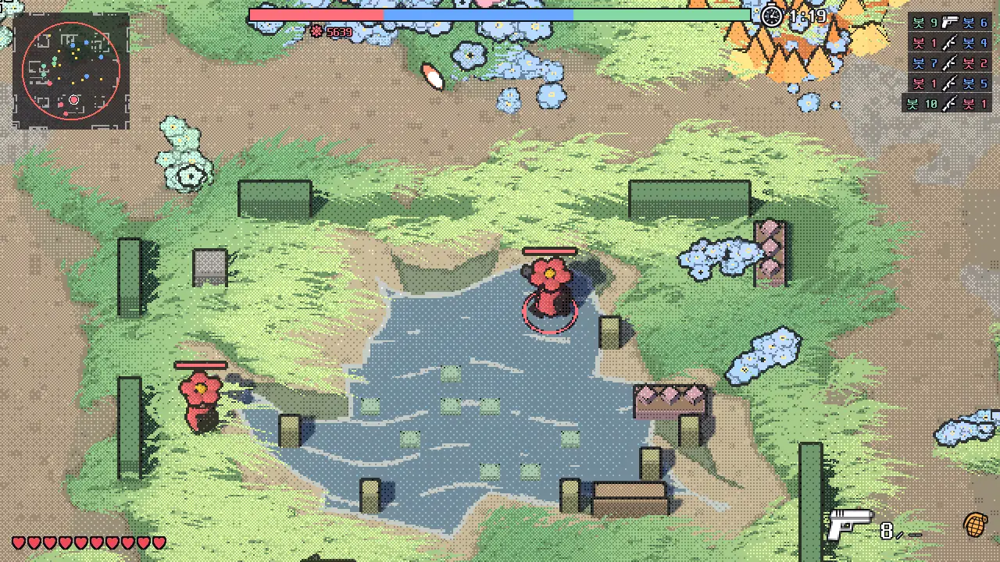

# Head Full of Flowers

A dithered remake of [head-full-of-flowers](https://github.com/scarf005/head-full-of-flowers) in Godot 4.7: pixel-art
fox-ear girls fight on a 3D field of grass and flowers.



Each hit plants flowers of your colour behind the target. A match lasts 90 seconds, and the arena shrinks all the
time. The side with the most petals on the ground at the end wins.

## Controls

| Action        | Keyboard and mouse    | Gamepad       |
| ------------- | --------------------- | ------------- |
| Move          | WASD or arrow keys    | Left stick    |
| Aim           | Mouse                 | Right stick   |
| Fire          | Left mouse button     | Right trigger |
| Throw         | Right mouse button, G | Left trigger  |
| Reload        | R                     | X             |
| Change weapon | Q, mouse wheel        | Y             |
| Pause         | Esc                   | Start         |
| Debug panel   | F3                    |               |

## Run

You need Godot 4.7 and [just](https://github.com/casey/just).

```sh
just run     # play
just test    # run the tests
just export  # build the web and Linux releases into build/
```

## Credits

See [assets/CREDITS.md](assets/CREDITS.md) for music, sounds, icons and the font.

## Licence

[AGPL-3.0-only](LICENSE)
